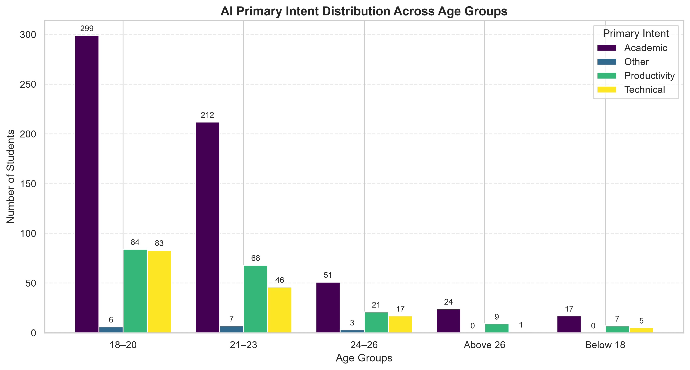
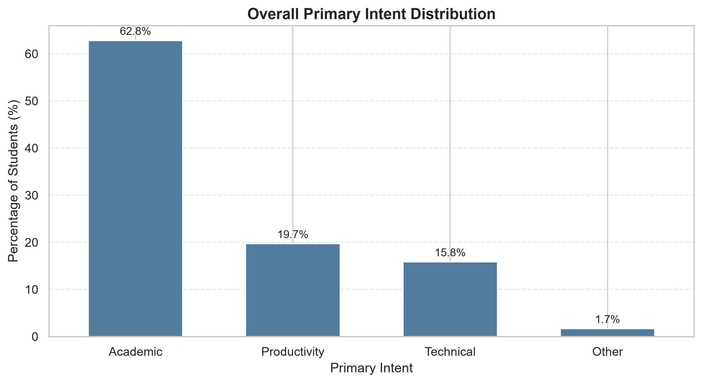

# 🎓 Generative AI College Students Usage Analysis

An end-to-end data analysis project examining how college students utilize Generative AI tools, built using Python (Pandas, NumPy, Matplotlib, Seaborn).

---

## 📁 Project Structure

- `student_gen_ai_analysis.py`: The complete, optimized Python script for data processing and analysis.
- `Generative_AI_College_Students_960_genuine_Responses.csv`: The raw dataset containing 960 student responses.
- `Generative_AI_College_Students_960_genuine_Responses_v2.csv`: The cleaned and processed dataset (`_v2` version).
- `age_vs_intent_chart.png`: Visual distribution of AI primary intent across different age groups.
- `overall_intent_chart.png`: Overall percentage distribution of primary intents.

---

## 🛠️ Data Processing & Cleaning Pipeline

1. **Standardization:** Renamed raw columns into clean, uniform `snake_case` format.
2. **Data Hygiene:** Stripped whitespace, handled missing values, and standardized text casing (`.title()`).
3. **Categorization:** Mapped specific primary purposes into broader analytical categories (`Academic`, `Technical`, `Productivity`, `Other`).
4. **Exporting:** Generated a clean version-controlled dataset (`_v2`) ready for reporting.

---

## 📊 Key Visualizations

### 1. AI Primary Intent Distribution Across Age Groups


### 2. Overall Primary Intent Distribution (%)


---

## 🚀 How to Run the Code

Make sure you have the required libraries installed, then run the analysis script:

```bash
pip install pandas numpy matplotlib seaborn
python student_gen_ai_analysis.py
